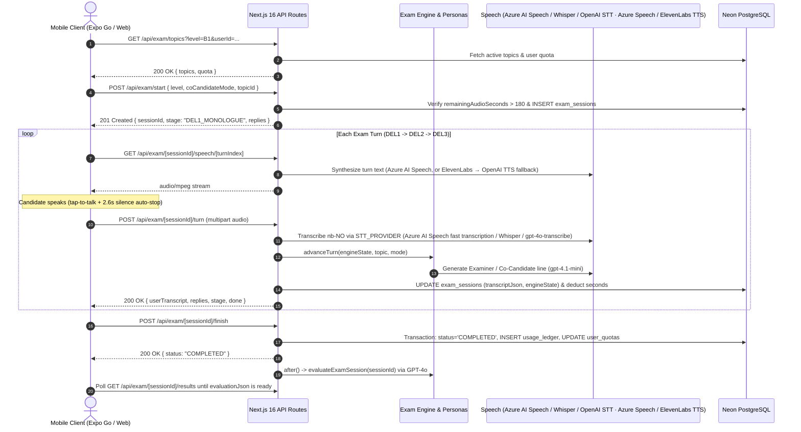

# Architecture & System Design

This document describes the architectural topology, service interactions, and lifecycle flows of the Norwegian Oral Exam Simulator across the React Native (Expo Go / Web) client, Next.js 16 API control plane, deterministic exam state machine, AI providers, and Neon PostgreSQL database.

---

## 1. System Topology

```
┌──────────────────────────────────────────────────────────────┐
│            React Native Client (Expo Go & Web)               │
│                                                              │
│  ├── AuthScreen.tsx        (Login, Register, Google OAuth)   │
│  ├── ExamSetupScreen.tsx   (Level, topic, mode, quota)       │
│  ├── ExamRoomScreen.tsx    (expo-audio, turn state, stages)  │
│  ├── ExamResultsScreen.tsx (Rubric scores, corrections)      │
│  └── HowTo / Terms / Privacy Policy Screens                  │
└──────────────────────┬───────────────────────▲───────────────┘
                       │ REST + Audio Streams  │
                       ▼                       │
┌──────────────────────────────────────────────┴───────────────┐
│                 Next.js 16 Control Plane                     │
│  ├── app/admin/page.tsx                     (Web Admin Portal)│
│  ├── api/admin/exams & api/admin/config     (Exams & Tiers)  │
│  ├── api/auth/*                             (Better Auth/JWT)│
│  ├── proxy.ts                               (CORS headers)   │
│  ├── GET  /api/exam/topics                  (Catalog/quota)  │
│  ├── POST /api/exam/start                   (Random/Init)    │
│  ├── POST /api/exam/[id]/turn               (STT+Engine+LLM) │
│  ├── GET  /api/exam/[id]/speech/[turnIndex] (TTS MP3 stream) │
│  ├── POST /api/exam/[id]/finish             (Ledger + Eval)  │
│  └── GET  /api/exam/[id]/results            (Result polling) │
└──────────┬───────────────────────────────┬───────────────────┘
           │                               │
           ▼                               ▼
┌─────────────────────────────────────┐   ┌─────────────────────────────┐
│ AI Provider Layer (ai-provider.ts)  │   │  Neon PostgreSQL (Drizzle)  │
│  ├── LLM/Eval: Azure OpenAI | OpenAI│   │  ├── exam_topics            │
│  ├── STT (STT_PROVIDER):            │   │  ├── user_quotas            │
│  │   Azure Speech | Whisper | OpenAI│   │  ├── exam_sessions          │
│  └── TTS: Azure Speech | ElevenLabs │   │  ├── usage_ledger           │
│      (+ OpenAI TTS fallback)        │   │  ├── user, session, account │
│  429/503 retry with backoff         │   │  ├── tier_configs           │
│                                     │   │  ├── referral_rewards       │
│                                     │   │  └── system_configs         │
└─────────────────────────────────────┘   └─────────────────────────────┘
```

---

## 2. Deterministic Exam State Machine & Random Selection (`src/server/*`)

When starting an exam via `POST /api/exam/start`:
- When `topicId` is omitted or set to `'RANDOM'`, the backend randomly selects an active exam topic for the requested CEFR level (`B1` or `B2`).
- The backend then draws a random subset of up to 3 follow-up questions from the exam's Del 3 pool (`followUpQuestionsNo`) and persists them in `session.engineState.selectedFollowUpQuestionsNo`.

Each exam session tracks its state in `exam_sessions.engine_state`:
- **`DEL1_MONOLOGUE`**: Sensor greets candidate and presents the Del 1 monologue prompt (`monologuePromptNo`). After the candidate finishes their presentation, transitions to `DEL2_AI` (if `AI_PEER`) or `DEL2_HUMAN` (if `HUMAN_LOCAL`).
- **`DEL2_AI`**: Sensor introduces the Del 2 discussion prompt (`discussionPromptNo`), and the AI Co-Candidate opens with a brief stance. Over 5 candidate turns (`del2TurnCount < 5`), the AI Co-Candidate debates naturally in spoken Norwegian. On the 5th turn, transitions to `DEL3`.
- **`DEL2_HUMAN`**: Sensor introduces the Del 2 discussion prompt and steps back as a passive moderator while two candidates discuss locally. Each candidate recording is appended to the transcript until the candidates tap `"Avslutt diskusjon (Gå til Del 3)"` (`endDiscussion: true`), transitioning to `DEL3`.
- **`DEL3`**: Sensor asks each follow-up question from the session's randomly selected Del 3 questions (`selectedFollowUpQuestionsNo`) sequentially (`followUpIndex`). After the last question is answered, transitions to `DONE`.
- **`DONE`**: Sensor thanks the candidate(s) and concludes the oral exam. Post-exam HK-dir rubric evaluation (`gpt-4o`) evaluates the candidate against the exact Del 1 monologue, Del 2 discussion, and randomly chosen Del 3 questions assigned to the session.

---

## 3. End-to-End Execution Sequence


