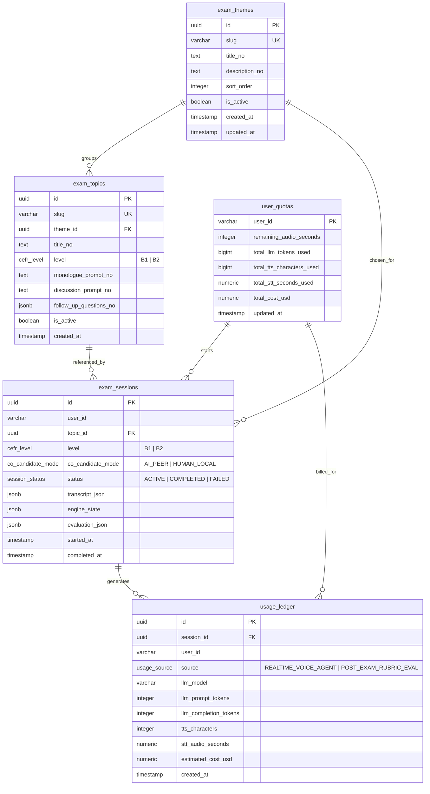

# Database Schema & Models

The database layer is managed using **PostgreSQL** (hosted on Neon Serverless) and **Drizzle ORM** with TypeScript type generation. The active schema is defined in [`src/db/schema.ts`](../src/db/schema.ts).

---

## 1. Entity Relationship Diagram (ERD)



---

## 2. PostgreSQL Tables & Columns

### 2.0 `exam_themes`
Themes/categories (e.g. "Familie og barn") that group many question sets. Candidates pick a theme (or random); questions are drawn randomly from the theme's sets.

| Column | Type | Constraints | Description |
| :--- | :--- | :--- | :--- |
| `id` | `UUID` | `PRIMARY KEY`, `DEFAULT gen_random_uuid()` | Unique theme UUID. |
| `slug` | `VARCHAR(100)` | `NOT NULL`, `UNIQUE` | URL-safe identifier (e.g. `'familie-og-barn'`). |
| `title_no` | `TEXT` | `NOT NULL` | Norwegian theme title. |
| `description_no` | `TEXT` | `NULLABLE` | Short description shown on the setup screen. |
| `sort_order` | `INTEGER` | `NOT NULL`, `DEFAULT 0` | Display order. |
| `is_active` | `BOOLEAN` | `NOT NULL`, `DEFAULT true` | Theme availability flag (inactive themes are excluded from all draws). |
| `created_at` / `updated_at` | `TIMESTAMPTZ`| `NOT NULL`, `DEFAULT now()` | Timestamps. |

### 2.1 `exam_topics`
Question sets (Del 1 monologue, Del 2 discussion, Del 3 follow-up pool) for official HK-dir B1 and B2 oral examinations. Each set belongs to a theme.

| Column | Type | Constraints | Description |
| :--- | :--- | :--- | :--- |
| `id` | `UUID` | `PRIMARY KEY`, `DEFAULT gen_random_uuid()` | Unique topic UUID. |
| `slug` | `VARCHAR(100)` | `NOT NULL`, `UNIQUE` | URL-safe identifier (e.g. `'kollektivtransport-gratis'`). |
| `theme_id` | `UUID` | `NULLABLE`, `FK -> exam_themes(id) ON DELETE SET NULL` | Owning theme (indexed). Unthemed sets are only used as a fallback for random exams. |
| `title_no` | `TEXT` | `NOT NULL` | Official Norwegian title. |
| `level` | `cefr_level` | `NOT NULL` | Target level (`'B1'` or `'B2'`). |
| `monologue_prompt_no` | `TEXT` | `NOT NULL` | Prompt for Del 1 individual monologue. |
| `discussion_prompt_no`| `TEXT` | `NOT NULL` | Prompt for Del 2 debate/discussion. |
| `follow_up_questions_no`| `JSONB` | `NOT NULL`, `$type<string[]>` | Array of follow-up questions for Del 3. |
| `is_active` | `BOOLEAN` | `NOT NULL`, `DEFAULT true` | Topic availability flag. |
| `created_at` | `TIMESTAMPTZ`| `NOT NULL`, `DEFAULT now()` | Topic creation timestamp. |

### 2.2 `user_quotas`
Tracks candidate audio seconds balance and cumulative provider billing metrics.

| Column | Type | Constraints | Description |
| :--- | :--- | :--- | :--- |
| `user_id` | `VARCHAR(128)` | `PRIMARY KEY` | Candidate user ID. |
| `remaining_audio_seconds` | `INTEGER` | `NOT NULL`, `DEFAULT 1800` | Practice balance in seconds. Must be > 180 to start exam. |
| `total_llm_tokens_used` | `BIGINT` | `NOT NULL`, `DEFAULT 0` | Cumulative LLM prompt + completion tokens. |
| `total_tts_characters_used`| `BIGINT` | `NOT NULL`, `DEFAULT 0` | Cumulative synthesized characters via ElevenLabs / OpenAI TTS. |
| `total_stt_seconds_used` | `NUMERIC(10, 2)` | `NOT NULL`, `DEFAULT '0'` | Cumulative transcribed candidate speech seconds. |
| `total_cost_usd` | `NUMERIC(10, 6)` | `NOT NULL`, `DEFAULT '0'` | Lifetime estimated cost across all providers. |
| `updated_at` | `TIMESTAMPTZ` | `NOT NULL`, `DEFAULT now()` | Last update timestamp. |

### 2.3 `exam_sessions`
Records each practice exam session, deterministic engine state, conversational transcript turns, and post-exam rubric scorecard.

| Column | Type | Constraints | Description |
| :--- | :--- | :--- | :--- |
| `id` | `UUID` | `PRIMARY KEY`, `DEFAULT gen_random_uuid()` | Unique exam session identifier. |
| `user_id` | `VARCHAR(128)` | `NOT NULL` | Owning candidate ID (indexed). |
| `topic_id` | `UUID` | `NULLABLE`, `FK -> exam_topics(id)` | Question set used for Del 1 (indexed). |
| `theme_id` | `UUID` | `NULLABLE`, `FK -> exam_themes(id) ON DELETE SET NULL` | Theme chosen by the candidate; `NULL` for random exams (indexed). |
| `level` | `cefr_level` | `NOT NULL` | Exam level (`'B1'` or `'B2'`). |
| `co_candidate_mode` | `co_candidate_mode` | `NOT NULL` | `'AI_PEER'` or `'HUMAN_LOCAL'`. |
| `status` | `session_status` | `NOT NULL`, `DEFAULT 'ACTIVE'` | `'ACTIVE'`, `'COMPLETED'`, or `'FAILED'` (indexed). |
| `transcript_json` | `JSONB` | `NULLABLE`, `$type<TranscriptEntry[]>` | Full conversation transcript turns. |
| `engine_state` | `JSONB` | `NULLABLE`, `$type<SessionEngineState>` | Turn-based state machine stage & accumulated usage metrics. |
| `evaluation_json` | `JSONB` | `NULLABLE`, `$type<ExamEvaluation>` | Complete post-exam HK-dir evaluation. |
| `started_at` | `TIMESTAMPTZ` | `NOT NULL`, `DEFAULT now()` | Session start timestamp. |
| `completed_at` | `TIMESTAMPTZ` | `NULLABLE` | Session finish timestamp. |

### 2.4 `usage_ledger`
Granular audit records of resource consumption per session and source.

| Column | Type | Constraints | Description |
| :--- | :--- | :--- | :--- |
| `id` | `UUID` | `PRIMARY KEY`, `DEFAULT gen_random_uuid()` | Unique ledger record ID. |
| `session_id` | `UUID` | `NOT NULL`, `FK -> exam_sessions(id) ON DELETE CASCADE` | Associated session (indexed). |
| `user_id` | `VARCHAR(128)` | `NOT NULL` | Candidate user ID (indexed). |
| `source` | `usage_source` | `NOT NULL` | `'REALTIME_VOICE_AGENT'` or `'POST_EXAM_RUBRIC_EVAL'`. |
| `llm_model` | `VARCHAR(64)` | `NOT NULL` | Model name (e.g. `'gpt-4.1-mini'` or `'gpt-4o'`). |
| `llm_prompt_tokens` | `INTEGER` | `NOT NULL`, `DEFAULT 0` | Input tokens consumed. |
| `llm_completion_tokens` | `INTEGER` | `NOT NULL`, `DEFAULT 0` | Output tokens generated. |
| `tts_characters` | `INTEGER` | `NOT NULL`, `DEFAULT 0` | Synthesized voice characters. |
| `stt_audio_seconds` | `NUMERIC(10, 2)` | `NOT NULL`, `DEFAULT '0'` | Audio seconds processed. |
| `estimated_cost_usd` | `NUMERIC(10, 6)` | `NOT NULL` | Calculated cost in USD for this record. |
| `created_at` | `TIMESTAMPTZ` | `NOT NULL`, `DEFAULT now()` | Audit timestamp. |

### 2.5 `user` (alias `users`)
Core user profile, Better Auth account records, referral identities, and subscription tiers.

| Column | Type | Constraints | Description |
| :--- | :--- | :--- | :--- |
| `id` | `TEXT` | `PRIMARY KEY` | User UUID / ID string. |
| `name` | `TEXT` | `NOT NULL` | User full name. |
| `email` | `TEXT` | `NOT NULL`, `UNIQUE` | Email address. |
| `email_verified` | `BOOLEAN` | `NOT NULL`, `DEFAULT false` | Verified status flag. |
| `image` | `TEXT` | `NULLABLE` | Profile avatar URL. |
| `role` | `user_role` | `NOT NULL`, `DEFAULT 'USER'` | `'USER'` or `'ADMIN'`. |
| `subscription_tier` | `subscription_tier` | `NOT NULL`, `DEFAULT 'FREE'` | `'FREE'`, `'STANDARD'`, or `'PREMIUM'`. |
| `stripe_customer_id` | `VARCHAR(255)` | `NULLABLE` | Stripe Customer ID. |
| `iap_account_token` | `UUID` | `NOT NULL`, `UNIQUE`, `DEFAULT gen_random_uuid()` | Sent to the App Store (`appAccountToken`) and Google Play (`obfuscatedAccountId`) to link store purchases to the user. |
| `referral_code` | `VARCHAR(32)` | `NOT NULL`, `UNIQUE` | Unique 8-char referral code. |
| `referred_by_user_id`| `VARCHAR(128)` | `NULLABLE` | Referrer user ID if referred during signup. |

### 2.6 `tier_configs`
Configurable subscription limits, monthly pricing, and feature bullets.

| Column | Type | Constraints | Description |
| :--- | :--- | :--- | :--- |
| `tier` | `subscription_tier` | `PRIMARY KEY` | Plan tier (`'FREE'`, `'STANDARD'`, `'PREMIUM'`). |
| `daily_test_limit` | `INTEGER` | `NOT NULL` | Tests allowed per calendar day. |
| `price_cents` | `INTEGER` | `NOT NULL`, `DEFAULT 0` | Monthly price in NOK øre. |
| `currency` | `VARCHAR(3)` | `NOT NULL`, `DEFAULT 'NOK'` | ISO currency code. |
| `features_json` | `JSONB` | `NULLABLE`, `$type<string[]>` | List of features and perks for marketing and app UI. |
| `updated_at` | `TIMESTAMPTZ` | `NOT NULL`, `DEFAULT now()` | Timestamp of last admin update. |

### 2.7 `referral_rewards`
Tracks active bonus tests awarded for successful referrals.

| Column | Type | Constraints | Description |
| :--- | :--- | :--- | :--- |
| `id` | `UUID` | `PRIMARY KEY`, `DEFAULT gen_random_uuid()` | Reward identifier. |
| `referrer_user_id` | `VARCHAR(128)` | `NOT NULL`, `FK -> users(id)` | Recipient user ID. |
| `referred_user_id` | `VARCHAR(128)` | `NOT NULL`, `FK -> users(id)` | Referred friend user ID. |
| `bonus_tests_per_day` | `INTEGER` | `NOT NULL`, `DEFAULT 1` | Extra daily tests granted. |
| `starts_at` | `TIMESTAMPTZ` | `NOT NULL` | Activation timestamp. |
| `expires_at` | `TIMESTAMPTZ` | `NOT NULL` | Expiration timestamp. |

### 2.8 `system_configs`
Key-value store for global system settings such as referral bonus defaults.

| Column | Type | Constraints | Description |
| :--- | :--- | :--- | :--- |
| `key` | `VARCHAR(64)` | `PRIMARY KEY` | Configuration key (e.g. `'REFERRAL_BONUS_DAILY_TESTS'`). |
| `value` | `TEXT` | `NOT NULL` | Value stored as string. |
| `description` | `TEXT` | `NULLABLE` | Human-readable explanation. |
| `updated_at` | `TIMESTAMPTZ` | `NOT NULL`, `DEFAULT now()` | Last update timestamp. |

---

## 3. JSONB Data Structures

### `TranscriptEntry` (`transcript_json`)
```typescript
type ExamStage = 'DEL1_MONOLOGUE' | 'DEL2_AI' | 'DEL2_HUMAN' | 'DEL3' | 'DONE';

interface TranscriptEntry {
  speaker: string; // e.g. "Sensor", "Kandidat", "Medkandidat (AI)"
  role: 'EXAMINER' | 'AI_CO_CANDIDATE' | 'AI_COCANDIDATE' | 'CANDIDATE_1' | 'CANDIDATE_2';
  text: string;
  timestamp: number; // Milliseconds Unix epoch
  stage?: ExamStage;
  durationMs?: number;
}
```

### `SessionEngineState` (`engine_state`)
```typescript
interface SessionEngineState {
  engine: {
    stage: 'DEL1_MONOLOGUE' | 'DEL2_AI' | 'DEL2_HUMAN' | 'DEL3' | 'DONE';
    del1Nudges: number;
    del2Exchanges: number;
    del2StartedAt?: number;
    followUpIndex: number;
  };
  /** Randomly selected Del 3 follow-up questions for this specific session */
  selectedFollowUpQuestionsNo?: string[];
  /** Snapshot of the composed exam (Del 1/Del 2 may come from different sets/themes) */
  selectedPrompts?: {
    titleNo: string;
    monologuePromptNo: string;
    discussionPromptNo: string;
    monologueTopicId: string;
    discussionTopicId: string;
    followUpThemeIds: string[];
  };
  usage: {
    llmPromptTokens: number;
    llmCompletionTokens: number;
    ttsCharacters: number;
    sttAudioSeconds: number;
  };
}
```

### `ExamEvaluation` (`evaluation_json`)
```typescript
interface CriterionScore {
  score: number; // 1 to 10 scale
  feedbackNo: string;
  feedbackEn: string;
}

interface ConcreteCorrection {
  originalQuote: string;
  correctedNorwegian: string;
  grammarOrVocabRule: string;
}

interface CandidateEvaluation {
  speakerRole: 'CANDIDATE_1' | 'CANDIDATE_2';
  targetLevel: 'B1' | 'B2';
  assessedLevel: 'Under B1' | 'B1' | 'B2' | 'Over B2';
  passedTargetLevel: boolean;
  overallSummaryNo: string;
  overallSummaryEn: string;
  criteriaScores: {
    formidlingOgFlyt: CriterionScore;
    uttaleOgForstaelighet: CriterionScore;
    ordforrad: CriterionScore;
    grammatikkOgSetningsstruktur: CriterionScore;
  };
  concreteCorrections: ConcreteCorrection[];
}

interface ExamEvaluation {
  candidates: CandidateEvaluation[];
  evaluatedAt?: string;
  insufficientData?: boolean;
  notes?: string;
}
```

---

## 4. Drizzle Configuration & Migration Commands

- **Seed Database & Apply Schema**: `npm run db:seed` (creates/updates `engine_state` and populates official topics and test user quota).
- **Seed Norskprøven Content**: `npm run db:seed:norskprove` inserts the curated themes and question sets from `src/db/content/norskprove-themes.ts`. Safe for production: rows whose slug already exists are left untouched. Add `-- --dry-run` to preview without writing, or `-- --update` to overwrite existing rows with the same slugs.
- **Push Schema**: `npm run db:push` (applies schema directly to database).
- **Generate Migrations**: `npm run db:generate` (creates SQL migration files in `drizzle/`).
- **Inspect DB in Browser**: `npm run db:studio` (opens Drizzle Studio).
